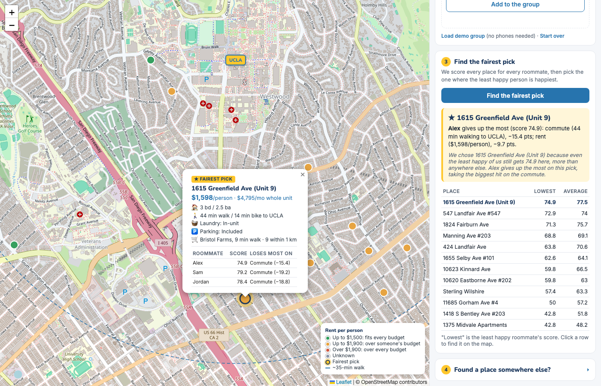
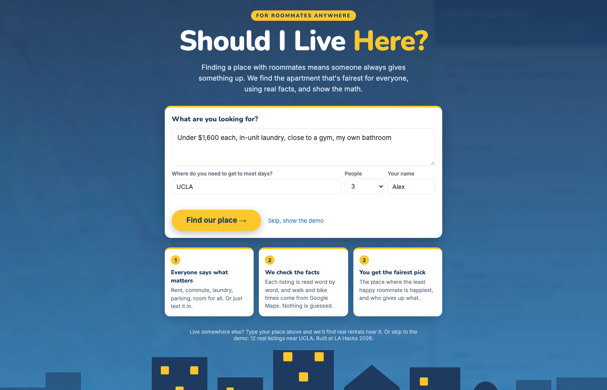
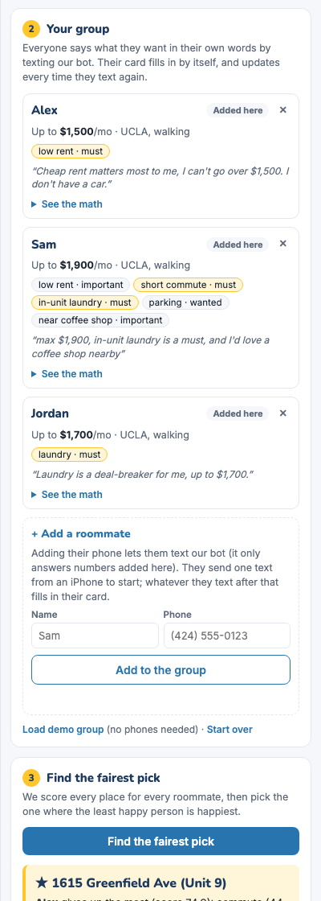
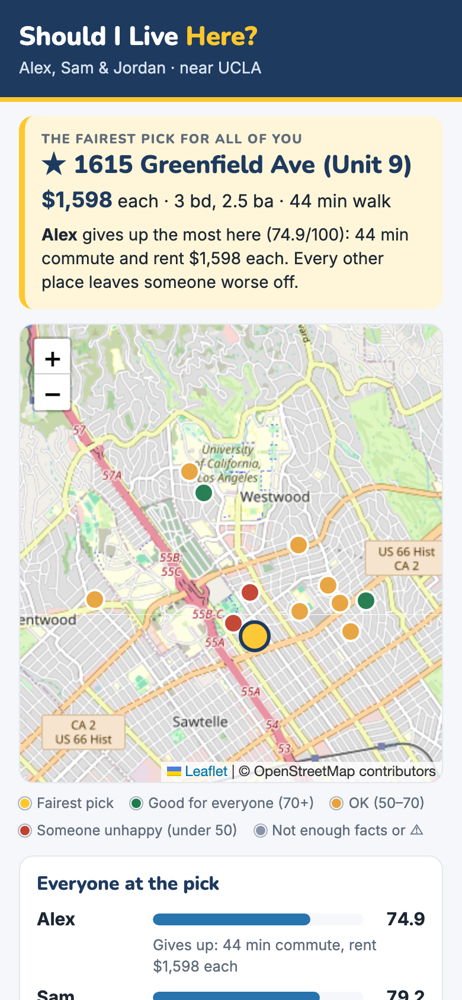

<!--
================================================================================================
NOTES FOR TU (hidden on GitHub; only visible while editing this file). Written by Freddy + Claude.
This README is our project's front page: a visitor should get what it is, why it matters and what
it looks like in 30 seconds, like a written demo. Every section below has a short draft people
see now, plus hidden notes with everything we built, so you can rewrite it in your own voice.
Keep or cut anything. Setup lives in docs/SETUP.md (don't move it back here).
The same material works for the Devpost: copy freely.
Screenshots are in docs/images/ (taken from the real app with the demo group: no real names or numbers).
Delete these notes when you're done (or leave them: GitHub doesn't show them).
================================================================================================
-->

# Common Ground

**Find the apartment that's fairest for your whole group, not just the person who found it.**

Everyone says what they want in their own words, by text or on the page. We check every fact,
measure real distances, and pick the place where the least happy roommate is happiest, with the math shown.

Built in 24 hours at LA Hacks 2026 (Applied Intelligence track).

<!--
NOTES: pitch and hook
- One-liner options: "Find the apartment that's fairest for everyone." / "The roommate group chat, solved."
- The problem in our words: finding a place with roommates means someone always gives something up, and nobody
  can see the trade-offs. Usually the loudest person or the one who found the listing wins.
- What's new about our approach: 1) FAIRNESS, not averages (maximin: the pick is the place where the least happy
  person scores highest). 2) Everyone talks in their own words, by iMessage, no app or account. 3) Nothing is
  guessed: every fact comes from the listing's exact words, Google Maps, or the user; unknown stays "unknown".
- Fairness example (great for the Devpost): Place A scores you 95, Sam 90, Jordan 30 (average 72).
  Place B scores 75, 70, 70 (also average 72). An average can't tell them apart; we pick B, because nobody is miserable.
-->

## How it works

1. **Say what you're looking for.** "Under $1,600 each, in-unit laundry, close to a gym, my own bathroom."
2. **See real listings near where you go.** Active rentals around your campus or office, on a map.
3. **Add your roommates by phone.** They text our iMessage bot whatever they want; their card fills in.
4. **Get the fairest pick.** It updates by itself as people text, and everyone gets a link to the map.

<!--
NOTES: the full flow (all tested on real phones on Oct 17)
1. Welcome screen (docs/images/welcome.png): "What are you looking for?" + where you go most days (default UCLA)
   + how many people + your name. Gemini reads the words; our code keeps only what's backed by their exact words.
2. Map: real active rentals from RentCast around that place (one request returns up to 500; near UCLA we got 500
   within 2 miles), filtered to enough bedrooms for the group and within budget, the 40 nearest shown, plus 12 demo
   listings. Every listing gets real walk/bike/transit/drive times from Google.
3. "Your group" (docs/images/group-cards.png): one card per person. "+ Add a roommate" = name + phone. They send one
   text from an iPhone to our Photon number (a shared line can't text first). The bot replies with a checklist.
   Every text after that adds to or changes their wishes ("actually I need parking", "don't need a gym anymore").
4. The pick re-runs on its own. When someone's text changes it, everyone else gets an "Update" text (at most one
   per person every 3 minutes) with a view-only map link that works on any phone (docs/images/phone-share.png).
- Commands people can text: "pick" (current pick + link), "reset" (clear their wishes), "help".
- Photos get "I can only read text for now".
-->

| Say what you want | Everyone's card fills in from their texts | Roommates see the map on their phones |
| --- | --- | --- |
|  |  |  |

### A real conversation with the bot

> **Sam:** Hi, it's Sam! Let's find our apartment.
>
> **Bot:** Hi Sam! I'm the apartment bot for Alex, Sam & Jordan. I'll find the place that's fairest for everyone.
> Tell me in your own words: your max rent, own bedroom or bathroom, laundry and parking, what you want nearby,
> where you go most days and how, anything that's a deal-breaker. You can text again anytime.
>
> **Sam:** max $1,900, in-unit laundry is a must, and I'd love a coffee shop nearby
>
> **Bot:** Got it, Sam: rent: important; in-unit laundry: must-have; near a coffee shop: important; budget $1,900/mo.
> Fairest pick for Alex, Sam & Jordan: 1615 Greenfield Ave (Unit 9), $1,598 each. You: 79.2/100.
> Least happy: Alex (74.9), mostly because of a 44-minute commute and rent at $1,598 each.
> Your wishes there: coffee shop: Way Home Coffee, 5.3 min walk. See the map and everyone's scores: [link]

<!--
NOTES: the conversation above is REAL output of app/photon_bot.py with the demo group (Oct 17), lightly shortened
(the welcome checklist is a bulleted list in the actual text). Other real replies we've seen:
- "Can't check "safe neighborhood": no listing or map shows that, so it's not scored."   (we never guess)
- "Update: Freddy changed what they want, and the fairest pick is now 11330 Ohio Ave. See the map: <link>"
- "Hi! I don't know this number yet. Ask your group to add you to the roommate list."
-->

## What makes it different

- **Fair, not average.** The pick is the place where the least happy person does best, and the app says who
  gives up the most and why ("Alex: 44-minute commute, −15.4 points").
  Say Place A scores you 95, Sam 90 and Jordan 30, and Place B scores 75, 70 and 70. Both average 72, so an
  average can't tell them apart. We pick B, because nobody is miserable.
- **Your own words, checked.** Gemini only sorts what people say and what listings say. Our code keeps a fact only
  if its exact words appear in the text. Nothing is guessed: unknown stays "unknown".
- **Real distances.** Walk, bike, transit and drive times, and the nearest gym or coffee shop, come from Google Maps.
- **No app, no account.** Roommates just text. The results open as a link on any phone.

<!--
NOTES: details judges like (Technical Depth / Originality). All of these are our own code, not a model call:
- Gemini never produces a score, a ranking or a distance (a project rule). It extracts; code validates every quote
  against the original text (and numbers must appear inside the quote) and throws out anything unbacked.
- "Near X" works for anything: gym, Trader Joe's, a dog park, Chipotle, a baseball field. Google finds the nearest
  one to EACH listing and the real walk there. Common words use Google's place types so "gym" finds gyms, not karate.
- "Listing has X" (gas included, pets allowed, A/C): answered only with a quote from the listing ("no pets",
  "window A/C"), else unknown.
- Specific asks count strictly: "in-unit laundry" means shared laundry scores 0 for that person.
- Budgets matter even below market: rent scores full at 75% of budget and zero at 2x budget (near UCLA a typical
  3-bedroom is ~$2,000/person, so a $1,000 budget would otherwise make every listing score zero).
- The per-room trap: some listings show one room's price with the whole house's bedrooms ("7 bed, $1,080"). If price
  per bedroom is under 40% of the area's typical, we flag it, keep the listed price, and never split it.
- A pick that doesn't state rent, bedrooms or bathrooms is flagged "⚠ check the listing" with the fairest fully known
  alternative next to it.
- Unknown facts are left OUT of a score (weights re-normalized), never filled in, and the listing is marked "partial data".
- Weights from words: must 5, important 4.5, wanted 4, neutral 3, nice to have 2, don't care 0.
- Scoring scales: commute full at 10 min, zero at 40; "near X" full at 5 min, zero at 25; laundry in-unit 1 /
  shared 0.4 / none 0; parking included 1 / paid 0.5 / none 0; enough bedrooms 1 else 0; own bathroom = one each
  for those who asked plus one shared.
-->

## Built with

| Part | What it does |
| --- | --- |
| **Gemini** (Google AI Studio) | Reads listings and people's wishes into structured facts, each with an exact quote; writes the plain-English summary |
| **Google Maps Platform** (Routes, Places) | Real walk/bike/transit/drive times, the nearest gym or coffee shop to each listing, finding places by name |
| **RentCast API** | Real active rental listings around any place |
| **Photon** (iMessage) | Roommates text the bot; the bot texts back picks and updates |
| **Cloudflare quick tunnel** | A view-only link to the results that works on any phone |
| **Python + FastAPI**, **Leaflet + OpenStreetMap** | Our backend (scoring, fair pick, validation, caching) and the map page |

<!--
NOTES: architecture (for a diagram or a "how we built it" paragraph). Who does what:
  roommate's text -> Photon -> app/photon_bot.py -> app/wishes.py (Gemini extracts, code checks quotes)
  listings: app/rentcast.py (live) | app/extract.py (pasted text, Gemini + quote checks) | data/demo_listings.json
  distances: app/maps_lookup.py (Google Routes + Places, every reply cached in cache/)
  scoring: app/scoring.py (per person, 0-100, breakdown)  ->  fair pick: app/group.py (maximin)
  one shared group for the page and the bot: app/group_store.py (file lock so they never overwrite each other)
  view-only link: app/share.py + scripts/share_link.py (through the tunnel ONLY the results page answers)
  page: static/ (index.html, app.js map, group.js cards, welcome.js, search.js, share.js phone page)
- Caching: every Gemini, Google and RentCast answer is saved, so the demo works with no internet and repeats cost $0.
- RentCast free plan is 50 requests/month; one area = one request; we stop at 45 so we're never charged.
- Reliability (stress-tested Oct 18): 730 requests at once with no errors; 6 programs making 300 edits at the
  same time with none lost; hostile input (script tags, emoji, huge texts, junk numbers) handled; every route tried
  through the public link (only the results page answers); a 100-text flood (no double texts, 2 update texts not 48);
  Photon failures (replies retried, never sent twice); no internet (the demo still works). 132 automated tests,
  none of which call the internet or send a text.
-->

## Try it

Setup takes about 5 minutes: see **[docs/SETUP.md](docs/SETUP.md)**. With no keys at all you can load the demo
group (Alex, Sam and Jordan, 12 real listings near UCLA) and see the fair pick, everyone's scores and the math.

Try this: load the demo group and the pick is **547 Landfair**. If Sam texts the bot "in-unit laundry is a must",
it moves to **1824 Fairburn**, the place with in-unit laundry, and everyone else gets an "Update" text.

<!--
NOTES: demo moments that work (also in TASKS.md, checked by tests):
- "Load demo group": the pick is 547 Landfair. Sam texting "in-unit laundry is a must" (or laundry 3 -> 5) moves it to
  1824 Fairburn. Alex's budget $1,500 -> $1,200 moves it to 424 Landfair, the cheapest ($1,083 each).
- Live with phones: someone texts a change, everyone else gets the "Update" text, they open the map link.
-->

## What's next

- A hosted version with separate groups (a group link or code), so it runs without our laptop.
- Laundry, parking and utilities for every live listing (our listing source doesn't include them yet).
- Group chats, so the whole house can talk to the bot together.

<!--
NOTES: honest limits worth mentioning (judges respect this):
- Runs on one laptop today; the share link works while that laptop runs the app.
- iMessage only (Photon's shared line); the bot can't text someone first, so each roommate sends one text to start.
- RentCast listings don't include laundry, parking or descriptions; those count as unknown until someone pastes the
  listing ("Found a place somewhere else?" on the page).
- US dollars and US listings only.
-->

## Team

Freddy Paniagua (AI and backend) and Tu Luong (UI and story). Built at LA Hacks 2026, with help from Claude Code.

<!-- TODO before submitting: add the Devpost link and the demo video link here. -->

<!--
NOTES: add links (GitHub/LinkedIn), the Devpost link and the demo video link here once they exist.
The 12 demo listings are real 3-bedroom listings near UCLA from our own search (reference/UCLA-Apartment-Map.html).
-->
